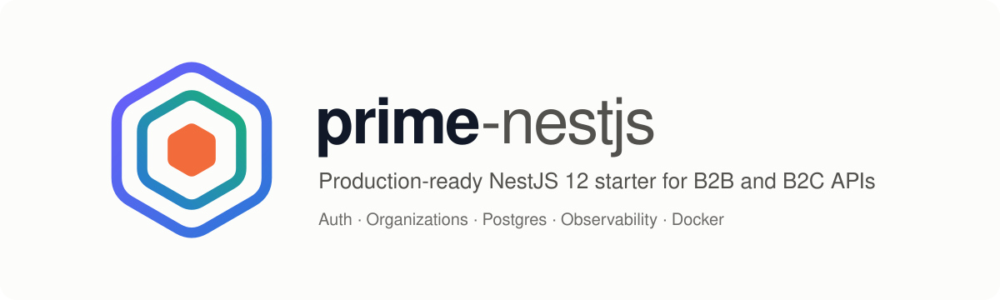
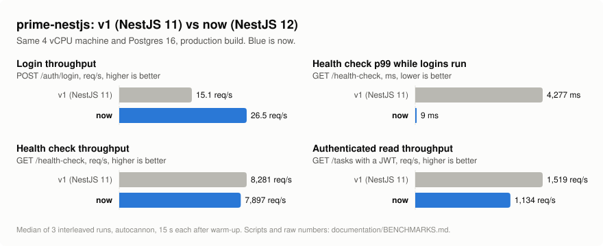
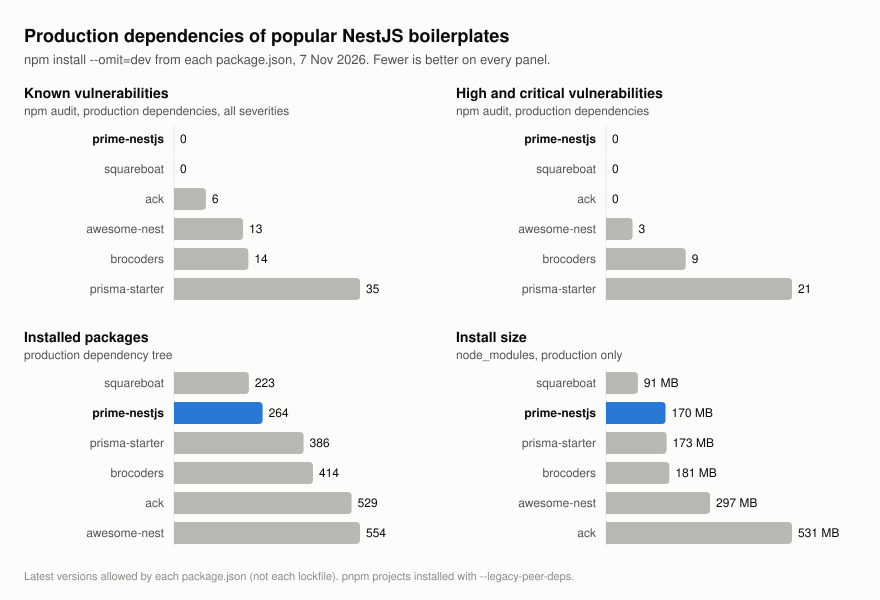

<p align="center">
  <picture>
    <source media="(prefers-color-scheme: dark)" srcset="documentation/assets/banner-dark.svg">
    
  </picture>
</p>

<p align="center">
  <a href="https://github.com/josephgoksu/prime-nestjs/actions/workflows/ci.yml"></a>
  
  
  
  <a href="LICENSE"></a>
</p>

A NestJS API starter you can put in production: authentication with rotating refresh tokens, organizations with roles for B2B apps, Postgres with migrations, rate limiting, structured logs and tracing. It stays small: 264 production packages and no known vulnerabilities.

## What you get

**Auth**
- RS256 access tokens (15 min) with rotating refresh tokens, reuse detection and logout
- scrypt password hashing off the event loop; old bcrypt hashes upgrade on login
- Global roles (`RolesGuard`) and per-organization roles

**B2B and B2C**
- Organizations with `owner`, `admin` and `member` roles, safe against concurrent role changes
- Personal data by default; send `X-Organization-Id` to work on an organization's data
- Non-members get 404, so tenant ids cannot be probed

**Data**
- PostgreSQL with TypeORM 1, versioned migrations, connection pooling, optional SSL
- Every query scoped to its owner or organization

**Production**
- Environment validated at startup, including the JWT key pair
- Rate limiting per client and route, stricter on login and registration
- Liveness and readiness probes, graceful shutdown
- JSON logs with request ids and secret redaction
- OpenTelemetry tracing for HTTP and Postgres, loaded only when you turn it on
- Docker image on Node 24 Alpine, non-root

**Developer experience**
- `./setup.sh` sets up `.env`, keys, dependencies, Postgres and migrations in one command (`--docker` also starts the API)
- Swagger at `/api`, Vitest unit and e2e tests, ESLint 9, Prettier, commitlint
- CI on Node 22 and 24 with a real Postgres, CodeQL
- `AGENTS.md` for coding agents

## Quick start

Needs Node.js 24 LTS (or 22.13+) and Docker.

```bash
git clone https://github.com/josephgoksu/prime-nestjs.git
cd prime-nestjs
./setup.sh          # .env, JWT keys, npm ci, Postgres in Docker, migrations
npm run start:dev
```

Open `http://localhost:3000/api` for Swagger. `./setup.sh --docker` runs the API in Docker too, and `./setup.sh --no-docker` uses your own Postgres from `.env`.

Without bash (for example on Windows):

```bash
npm ci
cp .env.example .env
npm run keys:generate
docker compose up -d --wait database
npm run migration:run
npm run start:dev
```

Try it:

```bash
curl -X POST localhost:3000/auth/register -H 'content-type: application/json' \
  -d '{"name":"Ada","email":"ada@example.com","password":"correct-horse-battery"}'
curl -X POST localhost:3000/auth/login -H 'content-type: application/json' \
  -d '{"email":"ada@example.com","password":"correct-horse-battery"}'
```

## Benchmarks

The NestJS 12 version against the previous NestJS 11 version, on the same machine:

<picture>
  <source media="(prefers-color-scheme: dark)" srcset="documentation/benchmarks/before-after-dark.svg">
  
</picture>

Password hashing no longer blocks the event loop, so a burst of logins does not stall every other request. Simple endpoints are slower than before: every request now gets a request id, and API requests also go through rate limiting, request logging and tenant scoping.

Production dependencies compared with other popular NestJS boilerplates:

<picture>
  <source media="(prefers-color-scheme: dark)" srcset="documentation/benchmarks/boilerplates-dark.svg">
  
</picture>

Method, raw numbers, a feature comparison and how to rerun everything: [documentation/BENCHMARKS.md](documentation/BENCHMARKS.md).

## Project structure

```
src/
├── auth/            # login, register, refresh tokens, JWT strategy, guards
├── organizations/   # organizations, memberships, OrganizationGuard
├── tasks/           # example feature: personal or organization tasks
├── users/           # User entity and service
├── health/          # liveness and readiness probes
├── logger/          # pino logger, request logging
├── config/          # env loading and validation, TypeORM data source
├── migrations/      # versioned schema migrations
├── instrumentation.ts / tracing.ts   # OpenTelemetry, off unless configured
└── main.ts
test/                # e2e tests against a real Postgres
scripts/             # key generation, benchmarks
```

`src/tasks/` is the pattern to copy for your own features.

## Scripts

```bash
npm run start:dev        # watch mode
npm run build            # production build
npm run start:prod       # run the build
npm test                 # unit tests
npm run test:e2e         # e2e tests (needs Postgres)
npm run lint             # lint and fix
npm run format           # Prettier
npm run migration:generate -- src/migrations/AddThing
npm run migration:run
npm run keys:generate    # RS256 key pair into .env
```

## Documentation

- [Authentication](documentation/auth.md)
- [Organizations](documentation/organizations.md)
- [Configuration](documentation/configuration.md): every environment variable
- [Observability](documentation/observability.md): health checks, logs, tracing
- [Benchmarks](documentation/BENCHMARKS.md)

## Contributing

Issues and pull requests are welcome. Use [conventional commits](https://www.conventionalcommits.org) and run `npm run lint:check`, `npm run format:check`, `npm run build` and `npm test` before you push. See [AGENTS.md](AGENTS.md) for the conventions.

## License

[MIT](LICENSE) © [Joseph Goksu](https://josephgoksu.com)

## Star history

[](https://star-history.com/#josephgoksu/prime-nestjs&Timeline)
