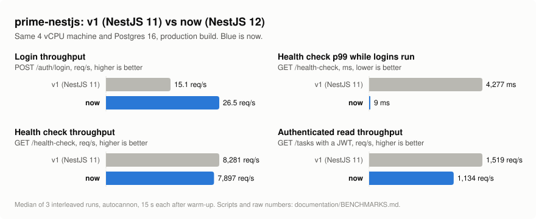
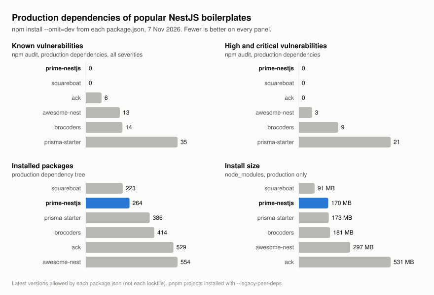

# Benchmarks

Two questions, measured on 7 November 2026:

1. How does the current NestJS 12 version perform compared with the previous NestJS 11 version of this project?
2. How does its dependency footprint compare with other popular NestJS boilerplates?

These are small, reproducible benchmarks, not a load test of your production setup. Your numbers will differ with hardware, network, database and payloads.

## 1. Before and after the upgrade

<picture>
  <source media="(prefers-color-scheme: dark)" srcset="benchmarks/before-after-dark.svg">
  
</picture>

Median of 3 interleaved runs per version:

| Scenario                                                                             | v1 (NestJS 11, commit `705c245`) | now (NestJS 12) | Change     |
| ------------------------------------------------------------------------------------ | -------------------------------- | --------------- | ---------- |
| Login throughput (`POST /auth/login`, 20 connections)                                | 15.1 req/s                       | 26.5 req/s      | 1.76x      |
| Login p99 latency                                                                    | 1,948 ms                         | 855 ms          | -56%       |
| Health check p99 while 10 clients log in                                             | 4,277 ms                         | 9 ms            | 475x lower |
| Health checks per second while 10 clients log in                                     | 23                               | 4,281           | 186x       |
| Health check throughput (`GET /health-check`, 50 connections)                        | 8,281 req/s                      | 7,897 req/s     | -5%        |
| Authenticated read throughput (`GET /tasks` with a JWT, 50 connections)              | 1,519 req/s                      | 1,134 req/s     | -25%       |
| Authenticated read p99 latency                                                       | 62 ms                            | 83 ms           | +34%       |
| Idle memory (RSS)                                                                    | 119 MB                           | 178 MB          | +50%       |
| Startup to first response (now applies migrations to an empty database; v1 has none) | 0.50 s                           | 0.80 s          | +0.3 s     |

**What changed and why**

- **Logins no longer freeze the API.** v1 hashed passwords with synchronous bcrypt on the event loop. While 10 clients logged in, a health check waited up to 4,277 ms (p99) and the server answered only 23 health checks per second. Now scrypt runs on the libuv thread pool: the same health check answers in 9 ms at p99, and login throughput is 1.76x higher.
- **Simple requests cost more.** Every request now gets a request id. API requests also pass through rate limiting, request logging and tenant scoping, and the user lookup runs on TypeORM 1; the health check skips rate limiting and logging. That costs about 5% on the health check and about 25% on an authenticated database read. For most APIs the database and the network dominate, and these features are things you would otherwise add yourself.
- **Memory.** Idle memory went from 119 MB to 178 MB, mostly from the extra modules (rate limiting, health checks, pino). The OpenTelemetry SDK is loaded only when tracing is on.

**Setup.** 4 vCPU cloud VM, Node 22.23, PostgreSQL 16 on the same machine, production build, `NODE_ENV=production`, info-level logs written to a file. Load from [autocannon](https://github.com/mcollina/autocannon) 9: 50 connections for 15 s after a 5 s warm-up (20 connections for login; 10 + 10 for the mixed test). Each connection uses its own `X-Forwarded-For` address and the app runs with `TRUST_PROXY=1`, so the rate limiter does the same work per request as with real separate clients. Limits are raised so no request is rejected. Between the 3 runs, each median moved by 5% or less.

## 2. Compared with other boilerplates

<picture>
  <source media="(prefers-color-scheme: dark)" srcset="benchmarks/boilerplates-dark.svg">
  
</picture>

|                                       | prime-nestjs                | [brocoders](https://github.com/brocoders/nestjs-boilerplate) | [awesome-nest](https://github.com/NarHakobyan/awesome-nest-boilerplate) | [prisma-starter](https://github.com/notiz-dev/nestjs-prisma-starter) | [squareboat](https://github.com/squareboat/nestjs-boilerplate) | [ack](https://github.com/andrechristikan/ack-nestjs-boilerplate) |
| ------------------------------------- | --------------------------- | ------------------------------------------------------------ | ----------------------------------------------------------------------- | -------------------------------------------------------------------- | -------------------------------------------------------------- | ---------------------------------------------------------------- |
| GitHub stars                          | 493                         | 4,423                                                        | 2,829                                                                   | 2,540                                                                | 789                                                            | 704                                                              |
| Last push                             | Nov 2026                    | Nov 2026                                                     | Sep 2026                                                                | Jul 2024                                                             | Oct 2026                                                       | Nov 2026                                                         |
| NestJS                                | 12.4                        | 11.1                                                         | 11.1                                                                    | 10.1                                                                 | 12.3                                                           | 12.0                                                             |
| Database                              | PostgreSQL, TypeORM         | PostgreSQL (TypeORM) or MongoDB                              | PostgreSQL, TypeORM                                                     | PostgreSQL, Prisma                                                   | SQL, Knex + Objection                                          | MongoDB, Prisma                                                  |
| API                                   | REST                        | REST                                                         | REST                                                                    | GraphQL                                                              | REST                                                           | REST                                                             |
| Tests                                 | Vitest                      | Jest                                                         | Jest                                                                    | Jest                                                                 | Jest                                                           | Vitest                                                           |
| Production packages                   | 264                         | 414                                                          | 554                                                                     | 386                                                                  | 223                                                            | 529                                                              |
| Install size                          | 170 MB                      | 181 MB                                                       | 297 MB                                                                  | 173 MB                                                               | 91 MB                                                          | 531 MB                                                           |
| Vulnerabilities (high + critical)     | 0                           | 14 (9)                                                       | 13 (3)                                                                  | 35 (21)                                                              | 0                                                              | 6 (0)                                                            |
| Refresh tokens                        | ✓ rotating, reuse detection | ✓                                                            | –                                                                       | ✓                                                                    | –                                                              | ✓                                                                |
| Teams or tenants                      | ✓ organizations             | –                                                            | –                                                                       | –                                                                    | –                                                              | ✓ workspaces, invites                                            |
| Rate limiting                         | ✓                           | –                                                            | ✓                                                                       | –                                                                    | –                                                              | ✓                                                                |
| Health checks                         | ✓                           | –                                                            | ✓                                                                       | –                                                                    | –                                                              | ✓                                                                |
| Structured logs                       | ✓ pino                      | –                                                            | –                                                                       | –                                                                    | –                                                              | ✓ pino                                                           |
| OpenTelemetry tracing                 | ✓                           | –                                                            | –                                                                       | –                                                                    | –                                                              | –                                                                |
| Social login, mail, file upload, i18n | –                           | ✓                                                            | i18n                                                                    | –                                                                    | –                                                              | partly                                                           |

**How to read it**

- prime-nestjs and squareboat are the only two with no known vulnerabilities in their production dependencies. squareboat is smaller, but it has no refresh tokens, rate limiting, health checks or multi-tenancy.
- ack has the most features (workspaces with invitations, API keys, policies, feature flags) and the largest install on disk: 531 MB, with 529 packages (only awesome-nest has more, 554).
- brocoders, the most popular, ships social login, mail and file uploads, which prime-nestjs does not. It is on NestJS 11, and 9 of its production packages have high or critical vulnerabilities.
- Stars measure popularity, not quality. prime-nestjs has the fewest stars in this list.

**Method.** For each project, the production dependencies from its `package.json` are installed with `npm install --omit=dev --ignore-scripts` into an empty directory, then counted, measured with `du`, and checked with `npm audit --omit=dev`, which counts vulnerable packages by severity, not individual advisories. Installing from `package.json` instead of each lockfile measures every project the same way, whatever package manager it uses, but resolves the newest versions its ranges allow. A project's own lockfile may pin different versions. pnpm projects (awesome-nest, ack) need `--legacy-peer-deps` under npm. Feature columns come from each repository's `package.json` and `src/` on the same day. Runtime benchmarks of the other projects are not included: they need their own services and configuration, and a fair setup for each is a separate piece of work.

## Rerun it

```bash
# Runtime: needs Postgres, the POSTGRES_* variables and JWT keys (an empty database is best)
npm run build
scripts/bench/run.sh my-run          # results in bench-results/my-run/

# Dependencies of any project
scripts/bench/deps.sh .
scripts/bench/deps.sh ../nestjs-boilerplate

# Charts, after editing documentation/benchmarks/benchmarks.json
node scripts/bench/charts.mjs
```
