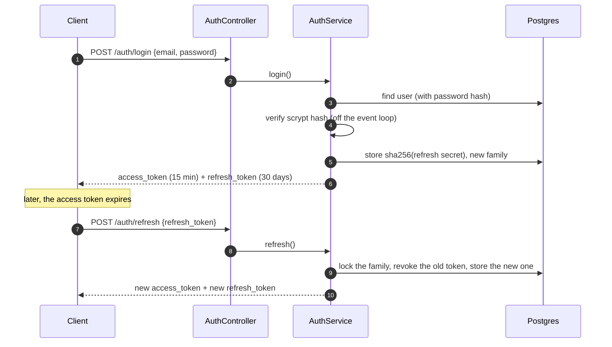

# Authentication

prime-nestjs signs short-lived access tokens (JWT, RS256) and pairs each one with a rotating refresh token. Clients send the access token on every request and use the refresh token to get a new pair when the access token expires.

## Endpoints

| Method | Path | Auth | What it does |
|---|---|---|---|
| `POST` | `/auth/register` | none | Creates a user (201). Log in afterwards to get tokens |
| `POST` | `/auth/login` | none | Checks the password and returns a token pair |
| `POST` | `/auth/refresh` | refresh token in the body | Returns a new pair and revokes the token it was given |
| `POST` | `/auth/logout` | refresh token in the body | Revokes the session (the token family). Returns 204 |
| `GET` | `/auth/me` | access token | Returns the signed-in user |

`register` and `login` use the stricter `THROTTLE_AUTH_LIMIT` rate limit. Emails are trimmed and lowercased, so they match case-insensitively.

`login` and `refresh` return a token pair:

```json
{
  "email": "ada@example.com",
  "token_type": "Bearer",
  "access_token": "eyJhbGciOiJSUzI1NiIs...",
  "expires_in": 900,
  "refresh_token": "3f6c1e0a-....9Qm2",
  "refresh_token_expires_at": "2026-12-07T10:00:00.000Z"
}
```

## Login and refresh



## How the tokens work

- **Access tokens** are RS256 JWTs. The private key signs and the public key verifies, so another service can verify tokens with only the public key. `JWT_EXPIRES_IN` sets the lifetime (default `15m`).
- **Refresh tokens** are opaque strings, `<id>.<secret>`. The database stores only the SHA-256 of the secret, so a database leak does not hand out working tokens.
- **Rotation**: every refresh revokes the token it used and issues a new one in the same family. `REFRESH_TOKEN_TTL_DAYS` (default 30) is a sliding lifetime: each refresh starts a new period, so it limits how long a session can stay idle.
- **Reuse detection**: if a token that was already rotated is presented again more than 10 seconds later, the whole family is revoked and that session must log in again. The 10 second window lets a browser with two tabs refresh at the same moment without signing the user out.
- **Concurrency**: a refresh claims its token with an atomic update, so two parallel refreshes with the same token cannot both succeed. Rotation and logout also take a Postgres advisory lock on the family, so a logout that runs during a refresh cannot miss the token that refresh issues.
- A daily cron job deletes tokens a day after they expire. Revoked tokens are kept until then, so a reused token is still recognised.

## Passwords

Passwords are hashed with scrypt (`N=2^14, r=8, p=5`) from `node:crypto`. Hashing runs on the libuv thread pool, so a burst of logins does not block other requests. Hashes from older versions of the project (bcrypt) are still accepted and are re-hashed with scrypt on the next successful login. Unknown emails are checked against a dummy hash so that response time does not reveal which emails exist.

## Roles

Users have a global role, `standard` (default) or `premium`. Protect a route with `RolesGuard`:

```ts
@Post('premium-echo')
@UseGuards(JwtAuthGuard, RolesGuard)
@Roles(Role.premium)
premiumEcho(@Body() body: Record<string, unknown>) { ... }
```

Roles inside an organization (`owner`, `admin`, `member`) are separate. See [organizations.md](./organizations.md).

## Keys

```bash
npm run keys:generate              # fills PRIVATE_KEY and PUBLIC_KEY in .env if they are unset
npm run keys:generate -- --force   # rotates them
npm run -s keys:generate -- --print # prints a new pair instead, for a secret manager (-s keeps npm's banner out of the output)
```

The app refuses to start when the keys are shorter than 2048 bits or do not belong together. After a rotation, existing access tokens stop working and clients get new ones with their refresh token. Use different keys for each environment and keep production keys in your secret manager, not in `.env` files in the repository.
